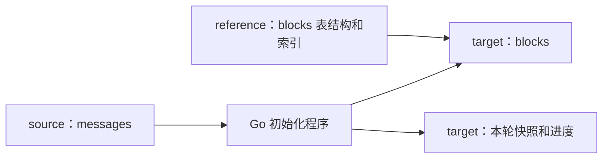
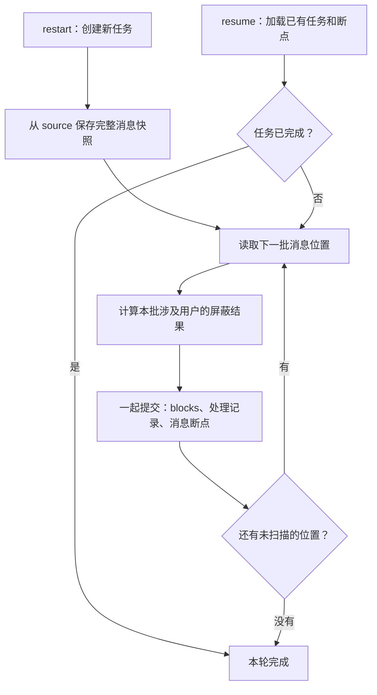

# blocks 转换说明

> [!NOTE]
> **部分取代**
> 业务规则章节仍有效。snapshot/init/restart/resume/CLI 相关章节已被 shuttle 内联投影取代，见 [100_shuttle-inline-projection](100_shuttle-inline-projection.md)。

`blocks` 保存的是“谁屏蔽了谁”。例如 `100 → 200`，表示 FID 为 100 的用户屏蔽了 FID 为 200 的用户。反过来的 `200 → 100` 是另一条关系，互不影响。

程序从 Shuttle 的 `messages` 读取屏蔽消息，算出这一轮数据里的最终状态，再写入目标库的 `blocks`。目前做的是初始化，不负责持续接收 Kafka 增量。

## 1. 先选对运行方式

> [!WARNING]
> **已被 shuttle 内联投影取代（见 [100](100_shuttle-inline-projection.md)）**
> 本节描述 Go 一次性 snapshot/init（restart/resume/CLI）的做法，仅作存档；增量现在由 shuttle 在同一事务里内联投影。业务规则以本文其他章节为准。

| 你现在要做什么 | 用什么命令 | 会发生什么 |
|---|---|---|
| 第一次初始化，或想重新读取源库当前数据 | `--restart` | 创建新任务，保存新快照，从头计算；已有 blocks 不会被清空 |
| 上次初始化中途停了，想继续剩下的部分 | `--resume RUN_ID` | 使用那一轮已保存的消息和进度，继续处理 |
| 只想看看会产生什么结果 | 不加 `--apply` | 只读预览，不写业务数据，也不保存断点 |

**已经完成的任务，再执行 resume 不会产生新数据。** 想把源库后来新增或修改的消息算进去，要用 restart 开始新一轮。

## 2. 三个数据库分别做什么

> [!WARNING]
> **已被 shuttle 内联投影取代（见 [100](100_shuttle-inline-projection.md)）**
> 本节描述 Go 一次性 snapshot/init（restart/resume/CLI）的做法，仅作存档；增量现在由 shuttle 在同一事务里内联投影。业务规则以本文其他章节为准。

| 名称        | 用途                                   | 程序如何使用                 |
| --------- | ------------------------------------ | ---------------------- |
| source    | Shuttle 采集的数据，主要读取 `public.messages` | 只读                     |
| reference | 对照数据库，提供标准的 blocks 表结构和索引            | 只读；不复制其中的业务记录          |
| target    | 最终保存转换结果                             | 创建表、写入 blocks，并保存初始化进度 |



reference 决定“表长什么样”，source 决定“表里应该有什么关系”。两边的数据时间和覆盖范围可能不同，不能要求初始化后的行数一定等于 reference。

表结构和索引会一起核对，包括主键、索引列顺序、条件索引的 `WHERE`，以及已有的索引参数。目标表缺失时可以创建；已有结构不一致时会报错，不会直接删掉重建。

## 3. 哪些 messages 会转换成 blocks

只读取下面三类消息，并且要求 `body.type` 等于 `block`。`follow` 等其他关系不会混进来。

| messages.type           | 含义         | 例子           |
| ----------------------- | ---------- | ------------ |
| `5`：LINK_ADD            | 屏蔽一个人      | A 屏蔽 B       |
| `6`：LINK_REMOVE         | 取消屏蔽       | A 不再屏蔽 B     |
| `14`：LINK_COMPACT_STATE | 某个时间点的屏蔽名单 | A 的名单是 B、C、D |

普通消息的对应关系很直接：

```text
messages.fid                   → blocker_fid，谁发起屏蔽
messages.body.targetFid         → blocked_fid，屏蔽谁
messages.body.type = "block"    → 确认这是屏蔽关系
```

例如：

```json
{
  "fid": 100,
  "type": 5,
  "body": {"type": "block", "targetFid": 200}
}
```

它表示用户 100 屏蔽用户 200。程序还会检查原始消息的网络，当前只支持 Farcaster 主网。

### 先看消息是否仍然有效

Shuttle 不只追加新消息，也会给旧消息更新状态。以下三个字段只要有一个不为空，就说明这条消息已经失效：

| 字段           | 含义             |
| ------------ | -------------- |
| `deleted_at` | 消息已被删除或被其他状态替代 |
| `pruned_at`  | 消息已被节点清理       |
| `revoked_at` | 消息已被撤销         |

失效消息不能直接恢复一条有效屏蔽关系。但它的失效信息仍可能用于判断已有关系是否需要软删除。

这里的“消息有效”和“关系有效”不是一回事：**一条有效的取消屏蔽消息，表达的恰好是关系应当失效。**

### 同一对用户有多条消息，听哪一条

普通屏蔽和取消消息，先比较业务时间。时间更新的消息优先；同一时间既屏蔽又取消时，取消优先。同类型、同时间还有冲突时，用消息 hash 按协议规则决胜，不靠数据库先读到了哪一行。

compact 记录的是某个时间点的完整屏蔽名单。程序先看最新一份有效名单，再结合单独的屏蔽和取消消息，算出最后屏蔽了谁。

与名单时间相同或更晚的消息，只要没有被标记为删除、清理或撤销，就仍然参与计算。例如，名单里是 B、C，同一时间还有一条有效的“屏蔽 D”，最后就是 B、C、D；如果“屏蔽 D”这条消息已经失效，就不能因为数据库里还存着它，又把 D 加回来。

## 4. blocks 中的一行如何变化

同一对有方向的用户只维护一行。比如 A 屏蔽 B，取消后又屏蔽，仍然复用原来的 ID。

这里的“幂等”就是：同样的数据再跑一遍，不会多出一条关系，也不会刷新没有变化的业务行。新一轮会新增任务记录和快照，这是正常的，不是 blocks 重复了。

| 算出的结果 | 目标库当前情况       | 怎么处理                    |
| ----- | ------------- | ----------------------- |
| 当前屏蔽  | 还没有这一行        | 新增，`deleted_at` 留空      |
| 当前屏蔽  | 已经是有效关系，内容也一样 | 不修改                     |
| 当前屏蔽  | 原来已软删除        | 恢复原行，清空 `deleted_at`    |
| 当前未屏蔽 | 原来是有效关系       | 给原行填写 `deleted_at`，保留记录 |
| 当前未屏蔽 | 原来已经软删除       | 不重复修改                   |
| 当前未屏蔽 | 从来没有这一行       | 跳过，不补造一条历史删除记录          |

例如，分三次初始化看到 A 对 B 的不同状态：

| 第一次：屏蔽 | 第二次：取消 | 第三次：再次屏蔽 |
|---|---|---|
| 创建关系 R，删除时间为空 | R 的删除时间有值 | 仍是 R，删除时间重新清空 |

### 每个字段保存什么

| blocks 字段 | 含义和写入规则 |
|---|---|
| `id` | 关系的 ID。新关系根据这对用户生成固定 ID；已有关系保留原 ID |
| `blocker_fid` | 发起屏蔽的用户 |
| `blocked_fid` | 被屏蔽的用户 |
| `timestamp` | 当前或最近一次生效屏蔽的业务时间；取消时保留它 |
| `created_at` | 这行第一次写入 target 的时间，以后不变 |
| `updated_at` | 业务内容实际改变的时间；重复运行不刷新 |
| `deleted_at` | 关系失效的时间；为空表示当前有效 |

屏蔽消息提供了 `displayTimestamp` 时，优先用它保存原始业务时间；没有时使用消息时间。只有 compact 提供关系依据时，使用 compact 时间。Shuttle 中的 `displayTimestamp` 已经是 Unix 毫秒，`messages.timestamp` 也已经转换成数据库时间，不再额外加 Farcaster 的时间起点。

`deleted_at` 优先使用取消消息或 compact 的业务时间。只有旧消息失效时，使用对应的失效标记时间。所有目标时间按 UTC 写入。

源库没有某条关系，不等于用户取消了它。源数据不完整时，程序不会据此清空 target 中所有没查到的关系。

## 5. 一轮初始化怎么跑，断点怎么保存

> [!WARNING]
> **已被 shuttle 内联投影取代（见 [100](100_shuttle-inline-projection.md)）**
> 本节描述 Go 一次性 snapshot/init（restart/resume/CLI）的做法，仅作存档；增量现在由 shuttle 在同一事务里内联投影。业务规则以本文其他章节为准。

初始化分成两步。

**第一步：保存这一轮的消息。** 程序在 source 里读取一份时间点一致的数据，按 `messages.id` 的顺序，把符合条件的消息保存到 target 的 `conversion_state`。这份副本就是本轮快照。保存完整份快照后，才进入业务处理。

**第二步：按批处理快照。** 默认每批推进 500 个消息位置。业务写入和处理位置一起提交：要么这一批都成功，要么一起回滚。因此不会出现“进度已经往前走，blocks 却没有写进去”的情况。



**扫描顺序不等于业务判断顺序。** 消息 ID 用来确定读到哪里，最终屏蔽状态仍由上一节的消息规则决定。

遇到某个用户时，程序会查看他在本轮快照中的完整 block 消息，只计算一次。假设第一批有 A 屏蔽 B，第十批才有 A 取消屏蔽 B，程序也能看到这次取消，不会因为分批就先写出错误的最终关系。

所以“推进了 500 个消息位置”不一定等于“写了 500 行 blocks”。有些消息属于已算过的用户，有些是取消消息，同一个用户也可能涉及很多条关系。

### 进度保存在哪里

都在 target 的 `conversion_state` 中：

| 表 | 保存什么 |
|---|---|
| `runs` | 任务 ID、运行状态、消息断点和统计 |
| `init_messages` | 这一轮完整的 block 消息快照 |
| `init_applied_fids` | 这一轮哪些用户已经计算过 |
| `blocks` | 用户对、目标关系 ID，以及上次计算的依据 |

这里的 `conversion_state.blocks` 是处理记录，真正给业务查询的关系表是 `public.blocks`。

每次 restart 都会保留一份新快照，目前没有自动清理。反复运行会占用更多空间；仍需要 resume 的快照应当保留。

## 6. 实际怎么执行

> [!WARNING]
> **已被 shuttle 内联投影取代（见 [100](100_shuttle-inline-projection.md)）**
> 本节描述 Go 一次性 snapshot/init（restart/resume/CLI）的做法，仅作存档；增量现在由 shuttle 在同一事务里内联投影。业务规则以本文其他章节为准。

下面的命令都在代码项目目录运行。Go 需要 1.25；核验脚本还需要 Python 3 和 `psql`。

```bash
cd /Volumes/Data/Code/dimension/farcaster-db-convertion
mkdir -p bin reports
go build -o bin/farcaster-init ./cmd/farcaster-init
```

连接配置沿用项目本地的 `.env.readonly`。文件名只是历史命名，实际权限如下：

| 配置项 | 需要的权限 |
|---|---|
| `SOURCE_DATABASE_URL` | 读取源数据 |
| `REFERENCE_DATABASE_URL` | 读取对照表定义和索引 |
| `TARGET_DATABASE_URL` | 写业务表，创建、维护表和初始化状态表 |

账号密码保存在本地配置文件，不放进文档或代码仓库。

### 第一次准备目标表

先看结构差异，不执行建表：

```bash
bin/farcaster-init schema blocks --env-file .env.readonly
```

确认后创建缺失的表和索引：

```bash
bin/farcaster-init schema blocks --env-file .env.readonly --apply
```

已有表和索引一致时，重复执行不会再建一套。若同名对象定义不同，或存在不匹配的额外索引，程序会停止并报出差异。

### 只预览转换结果

```bash
bin/farcaster-init init blocks --env-file .env.readonly
```

配置了 target 时，可以看到预计新增、更新、删除等数量；未配置 target 时，只能看到从 source 算出的结果，不能知道目标库实际会变化多少。如果配置了 target 但连接失败，程序会报错。预览不创建快照，也不能作为后续 resume 的起点。

### 从头开始新一轮

```bash
bin/farcaster-init init blocks --env-file .env.readonly --apply --restart
```

启动时会输出类似：

```text
initialization run_id=a9afa142-4afa-454e-a3f4-2823d52fcee6
```

记下本次的 `run_id`。它是任务 ID，不是 FID，也不是消息 ID。

需要改批次大小时，加 `--batch-size`，例如：

```bash
bin/farcaster-init init blocks --env-file .env.readonly --apply --restart --batch-size 100
```

批次小，单次回滚涉及的数据少；批次大，通常能减少提交次数。它不改变消息判断规则。

### 从断点继续

```bash
bin/farcaster-init init blocks --env-file .env.readonly --apply --resume RUN_ID
```

把 `RUN_ID` 替换成自己那一轮的任务 ID。两个模式不能同时指定；写入时也必须明确选一个。

resume 使用 target 里已经保存的快照，不会重新读取 source。source 暂时离线，也可以继续已保存好的这一轮；target 和 reference 仍需可以连接。

## 7. 怎么看进度，什么时候能 resume

> [!WARNING]
> **已被 shuttle 内联投影取代（见 [100](100_shuttle-inline-projection.md)）**
> 本节描述 Go 一次性 snapshot/init（restart/resume/CLI）的做法，仅作存档；增量现在由 shuttle 在同一事务里内联投影。业务规则以本文其他章节为准。

```bash
python3 scripts/check_blocks_progress.py --env-file .env.readonly
```

重点看这几项：

| 输出 | 怎么理解 |
|---|---|
| `run_id` 或 `id` | 这轮任务的 ID，续跑时使用 |
| `phase = capturing` | 正在保存快照；整份保存成功前，消息断点仍为 0 |
| `phase = applying` | 正在计算和写入业务结果 |
| `message_cursor` | 已经成功提交到第几个消息位置 |
| `captured_messages` | 本轮快照总共有多少条消息 |
| `status = completed` | 本轮处理完了，不代表 Shuttle 的历史 backfill 也完成了 |

例如 `message_cursor = 5500`、`captured_messages = 21043`，表示本轮已有 5,500 个消息位置成功处理，还有剩余位置待扫描。不要用 `last_fid` 判断完成百分比。

| 遇到的情况 | 下一步 |
|---|---|
| 在保存快照时中断 | 用 restart；尚未保存完整的源快照无法继续使用 |
| 快照保存完成后中断或报错 | 解决错误后，用同一个 run_id 执行 resume |
| 已完成，再执行 resume | 返回原结果，业务数据不变 |
| 已完成，想纳入后来新增或修改的消息 | 执行 restart，创建新一轮 |
| 已经创建过更新的一轮，又想 resume 旧任务 | 会被拒绝，避免旧快照覆盖新结果 |
| 旧版本任务没有保存快照 | 先用 restart 跑一次，之后的新任务才支持续跑 |

程序会阻止两个初始化进程同时写入同一个 target。初始化期间，也不要让其他不遵守这套锁的程序同时改写 blocks。

### 为什么 resume 输出了 Inserted，还不能说它刚刚插入了这么多行

结果中的 `Inserted`、`Updated` 等是**这轮任务的累计数量**。

例如 restart 插入了 14 行并完成，之后 resume 同一个任务，仍可能返回 `Inserted = 14`。这个 14 是原任务的累计写入数，resume 本次实际新增是 0。判断这次是否新增，要比较前后数据，不能只看累计数。

## 8. 怎么验证转换是否正确

> [!WARNING]
> **已被 shuttle 内联投影取代（见 [100](100_shuttle-inline-projection.md)）**
> 本节描述 Go 一次性 snapshot/init（restart/resume/CLI）的做法，仅作存档；增量现在由 shuttle 在同一事务里内联投影。业务规则以本文其他章节为准。

验证要看完整关系，不只是查一条记录存在不存在。随机选 100 个 FID 后，对每个用户检查：该有的关系有没有、取消的关系是否已失效、有没有多写、时间和 ID 对不对。

如果还没开始 restart，可以先保存 target 基线：

```bash
python3 scripts/verify_blocks_fids.py --env-file .env.readonly --snapshot-target reports/blocks-before.json
```

restart 完成后，把下面的 `RUN_ID` 替换成刚完成的任务 ID：

```bash
python3 scripts/verify_blocks_fids.py --env-file .env.readonly --run-id RUN_ID --size 100 --baseline reports/blocks-before.json > reports/blocks-100-fids.json
```

这个脚本会随机选取 **100 个不同 FID**，用独立计算方式核对本轮消息快照，并检查快照中的消息与 source 的对应内容。如果本轮没有 100 个不同 FID，就会明确报数量不足，不拿重复用户凑数。

如果没有提前保存基线，可以去掉 `--baseline`，但就无法完整检查原有行的创建时间是否被保留，以及本轮之前的记录是否被无故改写。存在从其他系统导入的历史 ID 时，也应提供基线，以便按“保留原 ID”核验。

### 验证完成后的 resume 是否真的没有重复写入

先保存 resume 前的数据，再执行 resume，然后保存一次结果：

```bash
python3 scripts/verify_blocks_fids.py --env-file .env.readonly --snapshot-target reports/before-resume.json
bin/farcaster-init init blocks --env-file .env.readonly --apply --resume RUN_ID
python3 scripts/verify_blocks_fids.py --env-file .env.readonly --snapshot-target reports/after-resume.json
cmp reports/before-resume.json reports/after-resume.json
```

`cmp` 没有输出且退出码为 0，表示前后的完整行内容相同，包括 ID 和时间字段，而不只是行数相同。这组检查适用于已经完成的 run；未完成的 run 续跑后，本来就可能新增或修改关系。

### 最近一次实库验证记录

以下是已提交版本 `bb24b08` 的一次验证结果，不是实时数据库总量：

| 检查项 | 结果 |
|---|---|
| 本轮快照 | 21,043 条消息，涉及 1,717 个 FID |
| restart | 新增 14 条；原有 20,957 条保持不变 |
| 随机 100 个不同 FID | 共核对 1,198 条关系，全部通过 |
| 本轮新增关系 | 14 条、涉及 8 个 FID，全部另行核验通过 |
| 同一完成任务的 resume | 新增、修改、删除均为 0 |
| resume 前后整表对比 | 20,971 行完全一致 |
| 重复用户对 | 0 |
| 表结构和索引 | 与 reference 一致 |

另外，隔离测试已验证中途失败回滚、强制终止后续跑、source 离线时续跑，以及取消消息和 compact 跨批次的情况。

## 相关资料

- [000003_表数据处理](000003_%E8%A1%A8%E6%95%B0%E6%8D%AE%E5%A4%84%E7%90%86.md)
- [000002_farcaster_db_convertion.excalidraw](000002_farcaster_db_convertion.excalidraw.md)
- [000001_CKafka 连接器（DataHub）](000001_CKafka-%E8%BF%9E%E6%8E%A5%E5%99%A8%EF%BC%88DataHub%EF%BC%89.md)：后续增量链路，本文的初始化命令不依赖它。
- 代码项目：`/Volumes/Data/Code/dimension/farcaster-db-convertion`
- 项目内运行说明：`README.md`
- 实库验证明细：`reports/checkpoint-restart-resume-validation.md`
