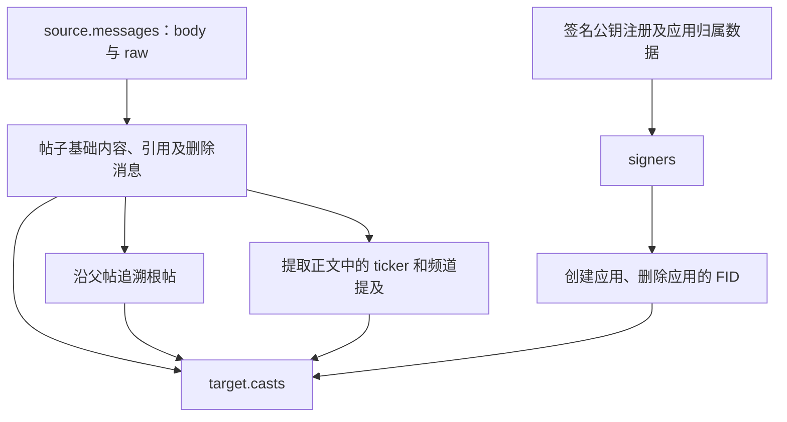

# casts 转换草稿

本文保存第一轮只读检查结果，还不是最终实现规格。当前没有创建 target.casts，也没有运行 casts 转换。后续先梳理并完成所需的基础数据，再回来确定 casts 的转换细节。

范围与 [000005_blocks 转换说明](000005_blocks-%E8%BD%AC%E6%8D%A2%E8%AF%B4%E6%98%8E.md) 一样，先做 source 数据库到 target 的初始化，暂不实现 DataHub/Kafka 增量。表结构和索引以 reference 为准，帖子数据从 source 生成，不拿 reference 的业务记录补入 target。

## 1. 先做哪些依赖

19 张表的整体依赖与建议顺序见 [000007_表依赖关系](000007_%E8%A1%A8%E4%BE%9D%E8%B5%96%E5%85%B3%E7%B3%BB.md)。

**建议先看 signers，再决定是否需要先完成 fids。** signers 能提供消息签名公钥与应用 FID 的对应关系。fids 是否必须先实现，要根据 signers 的实际来源、约束及转换流程判断，不能仅因为字段里有 FID 就认定它是前置表。

| 需要的数据 | 用在 casts 的哪里 | 是否必须先做另一张业务表 |
|---|---|---|
| source.messages 的发帖、删除消息及 raw | 正文、作者、时间、引用、删除状态 | 直接读取 source，不依赖其他 target 业务表 |
| signer 与应用 FID 的对应关系 | creator_app_fid、deleter_app_fid | 优先研究并实现 signers；还需确认 source 能否提供完整注册数据 |
| 作者、父帖作者、引用作者的 FID | fid、parent_fid、embedded_casts_fids | 消息本身带有这些数值；当前 casts 只有主键约束，没有要求先存在 fids 的外键 |
| 父帖和祖先帖子 | root_parent_hash、root_parent_url | casts 内部的数据依赖，需要追溯父帖，不是先做另一张表就能解决 |
| 频道 URL | parent_url、root_parent_url | 可从帖子及祖先帖子取得，目前不要求先做 channels |
| 正文里的 ticker、频道名称及位置 | ticker_mentions、channel_mentions 等 | 需要确认文本提取规则，不依赖频道成员、关注表 |
| 用户昵称、头像、用户名 | 当前 25 个字段不需要这些展示信息 | 暂不要求先做 profiles、usernames |



这里的箭头表示数据怎么提供，不表示 reference 中存在对应外键。先完成 signers 可以解决应用归属字段，但不能代替父帖补全或正文解析。

下一步查看 signers 时，需要回答：

1. reference.signers 的完整表结构、索引以及一把公钥与 FID、应用 FID 的对应方式。
2. source 从哪里提供注册、撤销及应用归属数据，是否已经采集完整。
3. 历史签名关系被撤销以后，如何继续识别过去帖子的应用归属。
4. signers 初始化是否真的依赖先生成 target.fids。

## 2. reference 的 casts 长什么样

2026-11-16 只读检查结果：25 个字段、13 个索引（包含主键索引），只有 id 主键约束，没有 hash 唯一约束。

几个直接影响实现的要求：

- root_parent_hash 不允许为空。回复的祖先缺失时，不能随便填自己的 hash。
- hash 索引是普通索引，不能直接使用 ON CONFLICT(hash) 做幂等写入。
- 正文搜索索引使用 pg_trgm 扩展。
- 正文 text 不允许为 NULL，但可以是空字符串，例如只有图片或引用的帖子。
- 数组字段允许 NULL。已检查的样本中，无内容时经常保存 NULL，需要继续核对它与空数组的口径。
- 时间列都是不带时区的 timestamp；写入时需要明确统一使用 UTC。

下面是从 reference 系统目录导出的结构和索引，仅供检查，尚未在 target 执行。

```sql
-- Read-only catalog export of reference public.casts; not executed against target.
-- The text trigram index requires pg_trgm.
CREATE TABLE public.casts (
  "id" uuid NOT NULL,
  "created_at" timestamp without time zone NOT NULL,
  "updated_at" timestamp without time zone NOT NULL,
  "deleted_at" timestamp without time zone,
  "timestamp" timestamp without time zone NOT NULL,
  "fid" bigint NOT NULL,
  "hash" bytea NOT NULL,
  "text" text NOT NULL,
  "parent_hash" bytea,
  "parent_fid" bigint,
  "parent_url" text,
  "root_parent_hash" bytea NOT NULL,
  "root_parent_url" text,
  "embedded_urls" text[],
  "embedded_casts" bytea[],
  "mentions" bigint[],
  "mentions_positions" smallint[],
  "ticker_mentions" text[],
  "ticker_mentions_positions" smallint[],
  "channel_mentions" text[],
  "channel_mentions_positions" smallint[],
  "embedded_casts_fids" bigint[],
  "embeds" jsonb,
  "creator_app_fid" bigint,
  "deleter_app_fid" bigint,
  CONSTRAINT "casts_pkey" PRIMARY KEY (id)
);

CREATE INDEX casts_channel_timeline_active_idx ON public.casts USING btree (root_parent_url, "timestamp" DESC, id DESC) WHERE (deleted_at IS NULL);
CREATE INDEX casts_embedded_casts_active_gin_idx ON public.casts USING gin (embedded_casts) WHERE (deleted_at IS NULL);
CREATE INDEX casts_fid_root_timeline_not_deleted ON public.casts USING btree (fid, "timestamp" DESC, id DESC) INCLUDE (hash, root_parent_url) WHERE ((deleted_at IS NULL) AND (parent_hash IS NULL));
CREATE INDEX casts_fid_timeline_not_deleted ON public.casts USING btree (fid, "timestamp" DESC, id DESC) INCLUDE (hash, root_parent_url) WHERE (deleted_at IS NULL);
CREATE INDEX casts_hash ON public.casts USING btree (hash);
CREATE INDEX casts_parent_hash ON public.casts USING btree (parent_hash);
CREATE INDEX casts_parent_hash_deleted ON public.casts USING btree (parent_hash) WHERE (deleted_at IS NULL);
CREATE INDEX casts_parent_timeline_not_deleted ON public.casts USING btree (parent_hash, "timestamp", id) WHERE (deleted_at IS NULL);
CREATE INDEX casts_root_parent_hash ON public.casts USING btree (root_parent_hash);
CREATE INDEX casts_text_active_trgm_idx ON public.casts USING gin (text gin_trgm_ops) WHERE (deleted_at IS NULL);
CREATE INDEX idx_casts_timestamp ON public.casts USING btree ("timestamp");
CREATE INDEX idx_casts_upsert ON public.casts USING btree (id, updated_at);
```

## 3. messages 如何对应 casts

| casts 字段 | 来源或计算方式 | 当前确认程度 |
|---|---|---|
| id | 目标侧生成 UUID，同一条 Cast 重跑时保持稳定 | 生成规则待定，不要求与 reference 的随机 ID 相同 |
| created_at、updated_at | 目标记录的创建和更新时间 | 具体口径待定，不能当作发帖时间 |
| timestamp | 发帖消息的 messages.timestamp，统一为 UTC | 已确认直接来源；不重复加 Farcaster 时间起点 |
| fid、hash | 发帖消息的作者 FID、消息 hash | 已确认 |
| text | body.text | 已确认，20 条相同 hash 样本的正文全部一致 |
| parent_hash、parent_fid | body.parent 为 Cast 时取得 hash、FID | 已确认 |
| parent_url | body.parent 为 URL 时取得 URL | 已确认 |
| root_parent_hash、root_parent_url | 查找最上层帖子，使用它的 hash 和 parent URL | 已验证 20 条样本，最深追溯 3 层 |
| embedded_urls | 消息内嵌的 URL 列表 | 已确认基本来源 |
| embedded_casts、embedded_casts_fids | 引用帖的 hash、作者 FID，完整信息需要 raw | 已在引用帖样本中核对 |
| embeds | URL 和引用帖的混合列表，保持原有顺序 | 需要匹配 reference 的 JSON 形状 |
| mentions、mentions_positions | body.mentions、body.mentionsPositions | 按协议原始位置保存，需检查目标 smallint 范围 |
| ticker_mentions、ticker_mentions_positions | 从正文提取 $DEGEN 等内容 | 提取边界、大小写和位置规则待确认 |
| channel_mentions、channel_mentions_positions | 从正文提取 /books 等内容 | 提取边界和位置规则待确认 |
| creator_app_fid | 根据发帖消息 signer 查应用归属 | 依赖 signer 注册信息，当前 source 样本存在缺失 |
| deleter_app_fid | 根据删除消息 signer 查应用归属 | 不能默认等于 creator_app_fid |
| deleted_at | 根据删除消息及发帖消息失效状态计算 | 软删除已确定，具体时间和各类失效状态的口径待确认 |

### 发帖与删除分开理解

- messages.type = 1：CAST_ADD，提供帖子正文等内容。
- messages.type = 2：CAST_REMOVE，body.targetHash 指向被删除的原帖。

删除消息自己的 hash 不是原帖的 hash。处理删除时，应按 targetHash 定位原帖，并核对作者 FID，再更新原记录的 deleted_at，不把删除消息插成一条新帖子。

原帖的 deleted_at、pruned_at、revoked_at 也需要检查；这些状态各自怎样影响 target.deleted_at，尚未完成逐项验证。不能只看“是否出现过删除消息”。

父帖删除不代表所有回复都删除。每条回复的删除状态由它自己的消息决定。

reference 中保留了软删除帖子。blocks 已接受的“取消消息找不到目标关系时直接跳过”，不能不加判断地套到 casts。只有删除消息、找不到发帖消息时，缺少正文等必填信息，应记录待补全；如何处理已经失效但内容仍在的发帖消息，需要单独确认。

### 根帖需要沿回复链查找

```text
A：原帖，parent_url 是某频道 URL
└─ B：回复 A
   └─ C：回复 B
```

C 应当保存：

```text
parent_hash      = B 的 hash
root_parent_hash = A 的 hash
root_parent_url  = A 的 parent_url
```

没有父 Cast 的原帖，root_parent_hash 为自己的 hash，root_parent_url 为自己的 parent_url；普通原帖没有 parent_url 时，根 URL 为空。

如果 source 缺少祖先，建议先保留待补全记录，找到祖先后再写入正式 casts。具体补全方式仍待决定。需要检测缺失父帖和异常循环，不能用错误的根帖填满非空字段。

### 引用帖需要解析 raw

核对 DimensionDev 的 Shuttle 代码后确认：CAST_ADD 转换为 body 时，把引用帖压成了 hash 字符串，没有保留引用作者的 FID。原始 protobuf raw 中仍有引用帖的完整 CastId。

所以 embedded_casts_fids 不能只靠 body.embeds 获得。优先解析 raw，恢复 URL、引用 hash、引用作者，并保持混合列表的原有顺序。

reference.embeds 的引用对象类似：

```json
{
  "castId": {
    "fid": 347,
    "hash": {
      "type": "Buffer",
      "data": [41, 231]
    }
  }
}
```

上面 data 只用两个字节演示格式，实际应保存完整 hash。Go 默认会把 []byte 编成 Base64，不能直接把默认结果当作 reference 的 JSON 格式。

### 应用 FID 需要 signer 注册数据

messages.signer 是签名公钥，不是用户 FID，也不是应用 FID。应根据签名注册记录查出应用归属。

检查的一条样本中，reference.signers 能把作者 347 的指定公钥对应到应用 FID 9152；当时 source 中该作者的 type=1 onchain_events 查询没有返回记录。这只说明该样本的这条数据路径尚不足以提供归属，不能据此认定整个 source 都缺失，也不能把 9152 写成固定值。其他注册数据来源仍需检查。

创建和删除可能由不同应用签名，因此 creator_app_fid、deleter_app_fid 要分别计算。历史 NULL 是否表示缺少数据，也需要结合注册覆盖范围核对。

### 正文提及的位置暂时不要猜

reference 样本中，$DEGEN 被提取为小写 degen；一些 ticker 和频道的位置落在 $、/ 前面的空格处。包含非 ASCII 字符的样本还涉及 UTF-8 字节位置。

目前只能确认“不能直接把 $ 或 / 的字符下标写进去”，还不能据此定死完整正则。需要继续收集句首、多空格、换行、中文、emoji、URL 等样本后确定规则。

mentions_positions 来源是协议位置，目标类型却是 smallint[]，写入时应检查范围，不能静默截断。

## 4. 已经验证了什么

用相同 hash 对齐了 20 条 source/reference 帖子：

| 检查项 | 结果 |
|---|---|
| 正文 | 20 / 20 一致 |
| 沿 source 父帖链计算根帖 hash | 20 / 20 与 reference 一致 |
| 沿 source 父帖链计算根 URL | 20 / 20 与 reference 一致 |
| 最深追溯层数 | 3 层 |
| 这组样本的父帖缺失 | 0 条 |

另有引用帖样本验证了 raw 中的引用作者 FID 与 reference 一致。这些检查说明基本映射和根帖追溯方向成立，不代表所有派生字段、删除状态或全量数据已经验证通过。

源库与对照库的采集范围和更新时间可能不同。相同 hash 的字段对照，比直接比较两边总行数更有意义。

## 5. 后续初始化方案草案

依赖数据准备好之后，建议分阶段处理：

1. 保存这一轮 source 中发帖和删除消息的快照，按确定顺序处理，避免运行期间源数据变化。
2. 整理每条 Cast 的基础内容、引用和删除信息，以发帖 hash 识别原帖。
3. 利用按 hash 查询的暂存数据或缓存追溯父帖，补齐根帖。不要每处理一条就扫描整张表。
4. 计算正文提及，补充应用归属，记录不能补全的数据及原因。
5. 写入与 reference 结构、索引一致的 casts，并将结果和处理进度一起可靠保存。

沿用 blocks 的 restart、resume 和幂等目标，但 casts 必须拥有独立的任务范围与处理记录，不能复用 blocks 的完成标记。具体快照和写入方案尚未实现。

## 6. 回来实现 casts 前要确认的事项

- signers 的初始化及历史应用归属是否可用，是否需要先完成 fids。
- 祖先帖子缺失时从哪里补，哪些记录暂不写入正式表。
- 只有删除消息或原发帖已失效时，怎样保留历史软删除记录。
- deleted_at、created_at、updated_at 的具体取值规则。
- ticker、频道提及的完整提取和位置规则。
- NULL 与空数组、embeds JSON 的精确格式。
- 保持 reference 索引不变时，如何使用稳定 ID、处理记录及并发控制保证幂等。

## 7. 代码和检查材料

- [Shuttle 的消息转换代码](https://github.com/DimensionDev/hub-monorepo/blob/main/packages/shuttle/src/utils.ts)
- [Snapchain 消息类型文档](https://snapchain.farcaster.xyz/reference/datatypes/messages)
- 项目本地 reports/casts-reference-schema.sql：reference 实际结构和索引导出。
- 项目本地 reports/casts-mapping-checks.json：20 条同 hash 样本的正文、根帖检查结果。

reports 是本地检查产物，可能被清理；本文已保存结构 SQL、映射结论及未决事项，不依赖这些报告才能阅读。
