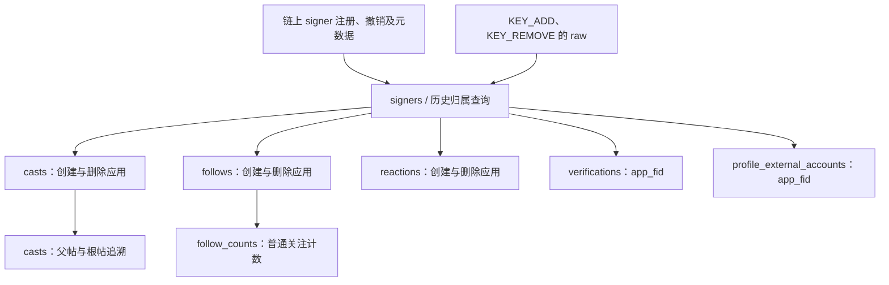
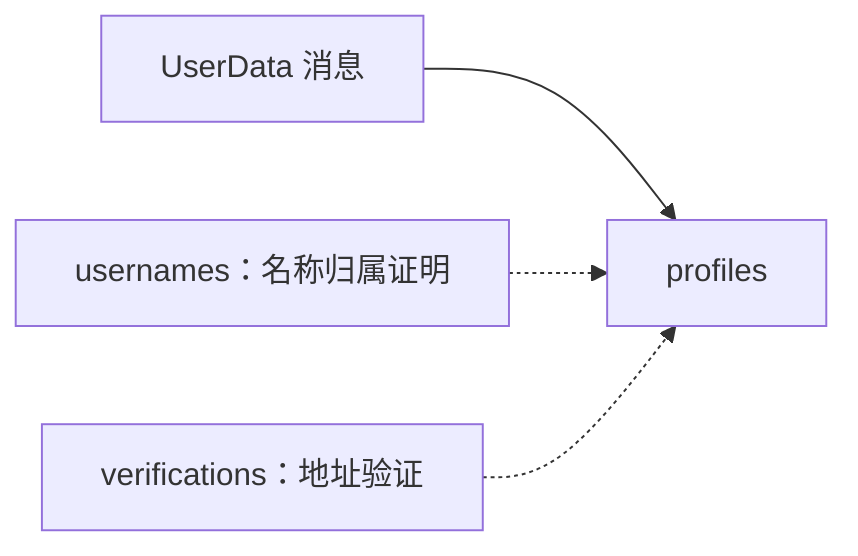
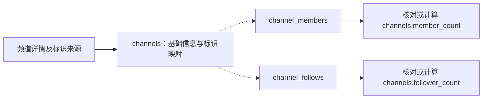

# 表依赖关系

这份梳理覆盖当前计划中的 19 张表。依据是 2026-11-16 对 reference 的字段、约束、索引检查，以及 source 实际表结构、少量样本和 DimensionDev Shuttle 当前 main 分支代码。

**先补齐基础数据源，优先解决 signers，再回到 casts。** fids 值得先作为账号基础表完成，但不能把所有带 FID 的表都当成必须等待 fids 写完。

本文梳理初始化依赖，暂不展开 DataHub/Kafka 增量。尚未确定的字段来源和计算规则会明确写为待确认，不据此开始实现。

## 1. “依赖”有三种，处理顺序不同

| 依赖种类 | 用人话解释 | 例子 |
|---|---|---|
| 数据库外键约束 | 父表里没这条数据，数据库就不让插入 | 本次检查的 19 张表之间没有声明外键 |
| 转换需要的数据 | 行可以插进去，但缺了它就算不全字段 | 不知道 signer 属于哪个应用，就填不了 creator_app_fid |
| 业务上的关联 | 展示时通常一起查询，但转换时未必需要先查另一张表 | reaction 消息自带目标帖 hash、FID，不必先查 casts 才能保存反应 |

19 张表都存在于 reference；这次查询没有发现它们声明的外键约束。下文的建议顺序主要是为了正确计算数据、减少返工，不是数据库强制的插入顺序。

一个字段写着 fid，只说明它引用一个用户编号。消息已经带有这个编号时，可以直接保存；不必先去 fids 生成编号，也不必先完成 profiles 才能识别作者。

## 2. 真正的数据入口不只有 messages

| 数据入口 | 主要提供什么 | 当前检查结果 |
|---|---|---|
| source.messages 的 body、raw 和状态字段 | 帖子、反应、关注、屏蔽、资料、地址验证等 | 已存在；body 对部分类型压缩或省略信息，必要时要解析 raw |
| source.onchain_events | 账号注册和转移、signer 注册和撤销、存储租赁、会员购买 | 已存在，但当前数据只有近期的一小段，历史覆盖不足 |
| source.usernames 及用户名证明 | 用户名、归属 FID、证明时间和类型 | 表已存在，本次 LIMIT 查询没有返回记录 |
| 频道数据接口、历史快照，或补齐后的新频道协议采集 | 频道详情、成员角色、关注关系等 | 当前 source 没有对应的独立表；采集和映射方案待定 |
| 评分和标签提供方 | Neynar 评分、Warpcast 等来源的用户标签 | 当前 source 没有相应表，也未确认已接入采集 |
| 实际 Parquet 导入任务 | 导入文件、版本和行组进度 | 当前 Go 消息转换流程不产生这种任务 |

不能把“source 没有单独的目标表”理解成“消息里一定没有这类信息”。例如外部账户可以在 UserData 消息里找到，而新的频道协议在仓库生成类型中也已出现。判断依据应当是实际消息格式、采集入口和历史覆盖范围。

### 当前发现的补采集缺口

本次查询 source.onchain_events 的结果如下。以下数量是这次查询的结果，源库继续采集后会变化。

| 事件类型 | 条数 | 覆盖 FID 数 | 事件时间范围（UTC） |
|---|---:|---:|---|
| 1：signer 事件 | 714 | 580 | 2026-11-12 01:57:35 至 2026-11-16 07:34:33 |
| 3：账号注册等事件 | 247 | 246 | 2026-11-12 03:29:49 至 2026-11-16 07:29:55 |
| 4：存储租赁事件 | 375 | 248 | 2026-11-12 03:29:49 至 2026-11-16 07:29:55 |

合计 1,336 条；当时没有 type=5 的会员购买事件。这个结果说明当前表内没有覆盖更早的历史，不能由此认定网络上不存在其他事件。

仓库示例程序的 App.reconcileFids 只调用 MessageReconciliation.reconcileMessagesForFid。虽然仓库已经提供 OnChainEventReconciliation 和 UsernameProofReconciliation，但该示例 backfill 入口没有调用它们。

因此，messages 的 backfill 进展，不代表链上事件和用户名证明也已经补齐。后续应先核对实际部署版本和入口，再决定如何接入这两条补采集路径。

## 3. 19 张表逐张看

“前置数据”说的是完整计算所需的信息；不表示每次处理一条消息都必须查询对应 target 表。也可以在同一轮快照中构建查找表、缓存或暂存结果。

| 表 | 主要原始来源 | 转换需要哪些前置数据 | 建议安排与未决事项 |
|---|---|---|---|
| fids | onchain_events 的账号注册、转移和恢复地址变更等事件 | 完整的账号事件历史 | 第一批基础表；不能只从 messages 中 DISTINCT fid，缺少 custody_address 等必填信息 |
| signers | onchain_events 的 signer 事件；新式 KEY_ADD / KEY_REMOVE 消息 | 注册元数据中的应用归属、撤销及历史状态；fids 可用于身份核对 | 第一批重点；不强制等待 target.fids 写完，但要有足够注册数据 |
| storage_rentals | onchain_events 的存储租赁事件 | 事件中的 FID、units、expiry、交易和 log_index | 可与 fids、signers 并行设计；LEND_STORAGE 消息不能直接当作一次链上租赁 |
| tier_purchases | onchain_events 的会员购买事件 | 会员类型、天数、付款人、交易和 log_index | 可独立转换；当前 source 缺少这类历史事件 |
| usernames | source.usernames、USERNAME_PROOF 消息或用户名证明补采集 | 用户名与 FID 的证明及状态 | 第一批基础数据；当前 source.usernames 为空，不能把资料中的 username 当作完整证明历史 |
| verifications | 地址验证添加、移除消息 | 完整填写 app_fid 时需要 signer 归属 | 第二批；地址、FID、协议可直接从消息取得 |
| profile_external_accounts | UserData 的 Twitter、GitHub 等消息 | signer 归属，用于必填 app_fid | 第二批；不要求先生成 profiles，账户名本身来自消息 |
| profiles | UserData 的头像、昵称、简介、URL、用户名、位置、主地址等消息 | 用户名证明、地址验证用于归属核对；部分派生字段可能需要额外解析或元数据 | 基础资料可独立生成；完整对齐时确认 usernames、verifications 的校验规则，以及 location、token_uri 的处理 |
| blocks | block 类型的 Link 添加、移除和 compact state | 当前字段不需要其他 target 业务表 | 已实现初始化；不应因为 fids 或 profiles 未完成而暂停 |
| follows | follow 类型的 Link 添加、移除和 compact state | 完整填写创建、删除应用字段时需要 signer 归属 | 第二批；不需要先完成 profiles |
| casts | CAST_ADD、CAST_REMOVE 及 raw | signer 归属；祖先帖内容；正文提及解析 | 第二批；根帖是自身依赖，不必先完成 channels、profiles、usernames |
| reactions | REACTION_ADD、REACTION_REMOVE | 完整填写创建、删除应用字段时需要 signer 归属 | 第二批；目标帖 hash、FID 或 URL 由消息提供，不强制等待 casts；可在 casts 后做关联核对 |
| follow_counts | 有效 follows 关系的汇总 | 普通数量依赖 follows；filtered 数量需要先明确过滤规则和相应数据 | 第三批；不能直接数原始 follow 消息。评分、标签是否参与 filtered 口径待确认 |
| channels | 频道详情接口或快照；新频道注册事件与更新消息是待核对路径 | 频道标识与 URL、负责人和配置；数量字段需要独立确认 | 独立频道分支；基础详情不必等待 casts。置顶帖 hash 可先保存，详情关联可后补 |
| channel_members | 频道成员接口或历史数据；新 CHANNEL_MEMBER 消息是待核对路径 | 频道标识、成员 FID、角色及成员时间 | 建议先建立频道标识和映射，再做成员；不能从发过帖推断为成员 |
| channel_follows | 频道关注接口或历史关系数据，协议来源待确认 | 频道标识、关注者 FID 和关系时间 | 与成员分开；不能从用户 follows 或频道发帖行为推断 |
| neynar_user_scores | Neynar 的评分数据源 | FID 与提供方给出的分数、更新时间 | 外部数据分支；不能承诺仅靠公开消息复刻同一评分 |
| user_labels | 标签提供方的数据；已见 warpcast_spam_labels 样本 | source、provider_fid、target_fid、标签内容和时间 | 外部数据分支；不能从 block 或评分自动替代提供方标签 |
| parquet_import_tracking | Parquet 导入程序的运行记录 | 实际导入文件、版本、行组和完成状态 | 工具记录表；可按 reference 建结构，但没有实际导入时不伪造历史记录 |

## 4. 最重要的几条依赖链

### signer 归属会被多张表使用

图中表示完整计算应用字段时需要的归属数据。casts、follows、reactions 的应用字段允许 NULL，可以选择先写基础内容后补，但这会增加回填工作；profile_external_accounts.app_fid 和 signers.app_fid 不允许 NULL，缺失时必须单独处理，不能直接写空值或猜固定应用。

当前 signers 表字段未完整表达所有新式 signer 的权限、滑动过期等信息。转换时可能还需要原始注册历史或独立辅助状态，不能把“当前未删除的 signers”当成历史应用归属的全部依据。

### 资料字段主要来自消息，证明表用于核对

虚线表示需要核对 reference 规则后才能确定的校验或补充关系，不表示 profiles 必须通过 JOIN 这两张表才能生成所有字段。

例如，首选用户名由 UserData 表达，而 usernames 保存名字归谁的证明；主钱包地址也有对应 UserData。不能直接把任意用户名证明或任意验证地址当作用户选中的首选值。

### 频道详情、关系和计数要拆开

频道关系本身只要拿到正确 channel_id 就可以保存，不要求数据库里先有一条 channels 记录。先做频道标识映射，是为了确认各来源说的是同一个频道。

数量字段可以来自提供方快照，也可以在规则和数据完整性确认后由关系表计算。这是两种待选择的来源，不能自动把二者混用。若使用本地汇总，应先写频道基础信息，再写关系，最后更新数量，避免形成相互等待。

## 5. 频道与新 signer 协议有版本差异

仓库当前生成的 MessageType 已包含：

- 16、17：KEY_ADD、KEY_REMOVE。
- 18 至 21：CHANNEL_UPDATE、CHANNEL_MEMBER、CHANNEL_PIN、CHANNEL_MODERATE。

OnChainEventType 也已包含 type=6 的频道注册事件。

但当前 Shuttle 消息转 JSON 的函数对 16、17 只保存 unsupportedMessageType 占位；对 18 至 21 没有转换分支，会进入未知类型错误。示例 onHubEvent 和链上补采集类型清单也没有覆盖频道注册。

这意味着“SDK 中有协议类型”不等于“Shuttle 已经完整采集并保存”。signers 应检查 raw 和链上两条路径；频道分支则需要先决定如何处理新协议、历史频道数据和 reference 的字段映射。

新频道消息中的 channelId 是 32 字节标识；reference.channel_id 是文本，且包含 URL、负责人、成员角色等历史业务字段，不能直接把新标识转成十六进制字符串就认为已经等价。仓库注册事件有 channelKey 和 label，可以作为标识映射的候选来源，但采集、历史对应及其他字段仍需验证。

所以目前不能断言“频道只能来自外部接口”，也不能承诺“当前 messages 已经能完整生成频道三张表”。

## 6. 建议的实现顺序

### 第一步：先补基础数据源

核对当前部署版本和补采集入口，补全或明确可用范围：

1. 账号注册、转移、signer、存储、会员等链上事件。
2. 用户名证明。
3. KEY_ADD / KEY_REMOVE 的原始消息及历史可用性。

这一步决定后续表能否完整还原。只先建空表，不能解决历史来源缺失。

### 第二步：完成基础表

优先 fids、signers、usernames。若目标是尽快推进 casts，signers 的归属查询是最直接的前置；fids、usernames 不需要为 casts 人为设成硬门槛。

storage_rentals、tier_purchases 可以使用同一批链上事件独立转换，不必排成 fids → signers → storage_rentals → tier_purchases 的串行链。

### 第三步：完成消息业务表

signer 归属可用后，分别推进：

- verifications、profile_external_accounts，再核对 profiles 的补充和校验字段。
- follows，再做 follow_counts 的普通计数。
- casts，再核对 reactions 与帖子的关联；reactions 的基础转换本身可以并行。

blocks 已有自己的转换和验证流程，不受这些新表的实现顺序影响。

### 第四步：频道和外部数据分别接入

频道分支先确定来源与标识映射，再处理成员、关注和数量。评分、用户标签另行接入。filtered 关注数量等派生字段，等过滤口径和数据来源明确后再算。

### 第五步：处理工具记录表

parquet_import_tracking 只有实际采用 Parquet 导入时，才按运行事实产生记录。当前 Go 初始化继续使用自己的 conversion_state 保存快照、进度和幂等记录；两者用途不同。

## 7. 当前可以确定与仍待确定的边界

已经确认：19 张表全部存在且没有声明外键；多张表有应用归属字段；source 的链上历史和用户名数据目前不足；示例 backfill 没有调用另外两类补采集；部分新协议未被 Shuttle 的转换入口覆盖。

仍待确认：signers 的完整历史归属规则、profiles 的派生及校验口径、filtered 关注数量的过滤标准、频道历史与新协议之间的对应、评分和标签的接入方式。本文把这些列为依赖检查项，没有把推测写成已经实现的行为。

## 8. 检查依据

- [Shuttle 示例程序：事件保存与 backfill 入口](https://github.com/DimensionDev/hub-monorepo/blob/main/packages/shuttle/src/example-app/app.ts)
- [Shuttle：消息 body 的转换](https://github.com/DimensionDev/hub-monorepo/blob/main/packages/shuttle/src/utils.ts)
- [Shuttle：数据库类型](https://github.com/DimensionDev/hub-monorepo/blob/main/packages/shuttle/src/shuttle/db.ts)
- [链上事件补采集类](https://github.com/DimensionDev/hub-monorepo/blob/main/packages/shuttle/src/shuttle/onChainEventReconciliation.ts)
- [用户名证明补采集类](https://github.com/DimensionDev/hub-monorepo/blob/main/packages/shuttle/src/shuttle/usernameProofReconciliation.ts)
- [仓库当前消息类型及字段](https://github.com/DimensionDev/hub-monorepo/blob/main/packages/core/src/protobufs/generated/message.ts)
- [仓库当前链上事件类型及字段](https://github.com/DimensionDev/hub-monorepo/blob/main/packages/core/src/protobufs/generated/onchain_event.ts)
- [新式 signer 与注册元数据](https://github.com/DimensionDev/hub-monorepo/blob/main/packages/core/src/gaslessKeys.ts)
- [Neynar User Score 官方说明](https://docs.neynar.com/docs/neynar-user-quality-score)：评分由 Neynar 提供并通过其数据接口返回，不能把自己的简单统计当作同一评分。
- [频道成员接口](https://docs.neynar.com/reference/fetch-channel-members)：是频道数据来源的候选，不代表已接入，也不保证可取回历史。

本次数据库检查报告保存在代码项目本地 reports/reference-table-dependencies.json、reports/source-table-dependencies.json、reports/dependency-source-checks.json。报告是本地检查产物，本文已保留关键结论。

## 9. 逐表实施约定

每张业务表开始写代码前，先保存该表的分析和实现计划。分析至少包括 reference 字段与索引、source 来源及覆盖范围、字段映射、冲突顺序、删除规则、幂等标识、重跑与断点行为、缺失数据的处理，以及验证方式。

实施顺序按依赖推进：先 fids，再 signers、usernames；链上来源的 storage_rentals、tier_purchases 可使用同一批基础能力独立完成。之后处理验证、资料、关注、帖子、反应，最后做汇总；频道、评分和标签依赖的来源另行分析。blocks 保持现有可用流程。

计划写完后在当前授权范围内继续实施和验证，不把“写了计划”等同于“实现完成”。每张表分别记录代码、隔离测试、真实数据核验的结果；源数据不完整时报告可生成的范围，不伪造缺失字段或复制 reference 记录。

当前实施：[000008_fids 分析与实现计划](000008_fids-%E5%88%86%E6%9E%90%E4%B8%8E%E5%AE%9E%E7%8E%B0%E8%AE%A1%E5%88%92.md)。

未完成与数据缺口：[000009_未完成与数据缺口](000009_%E6%9C%AA%E5%AE%8C%E6%88%90%E4%B8%8E%E6%95%B0%E6%8D%AE%E7%BC%BA%E5%8F%A3.md)。
