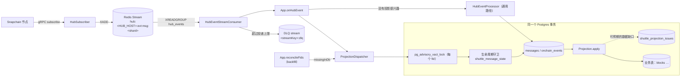

# Shuttle 内联业务投影

Status: 现行设计。一期：通用投影框架 + blocks。二期：一次性建好全部业务表（迁移 008）、dispatcher 支持链上事件、fids 投影与 ID_REGISTER 链上补齐。

## 背景

原设计（[000001](000001_CKafka-%E8%BF%9E%E6%8E%A5%E5%99%A8%EF%BC%88DataHub%EF%BC%89.md)、[000002](000002_farcaster_db_convertion.excalidraw.md)）的链路是：shuttle 写原始 `messages`/`onchain_events`，经 CKafka（DataHub）CDC 进 Kafka，再由 Go 服务写约 19 张业务表。Kafka 增量从未实现；Go 项目 `farcaster-db-convertion` 只做了一次性的 snapshot + init（blocks/fids/signers/usernames/storage_rentals/tier_purchases）。

新方向是**由 shuttle 在同步原始数据的同一个事务里直接写业务表**，不用 Kafka。消息通道就是 shuttle 现有的 Redis Stream（`hub:<HUB_HOST>:evt:msg:<shard>`，consumer group `hub_events`），不新增业务变更流。

前提：

- 一期只做通用投影框架，再把现有 blocks 迁进来。其他业务表在下一期用同一框架接入。
- 现在只跑增量。以后开启 backfill（reconcile）时，结果也必须正确。
- 旧文档中的**业务规则**（字段口径、有效性、冲突处理）继续有效；snapshot/init/restart/resume/CLI 部分已被本文取代。

## 架构



旧的 Excalidraw 草图（CKafka + Go service）仍在 [000002](000002_farcaster_db_convertion.excalidraw.md) 存档。

## 代码位置

`packages/shuttle/src/example-app/` 下：

```
projections/
  types.ts        RawChange / ProjectionSource / Projection 接口
  dispatcher.ts   ProjectionDispatcher：锁、原始落库 + 生命周期守卫、调用投影
  lifecycle.ts    消息生命周期守卫（shouldApply / recordState）
  issues.ts       数据缺口写 shuttle_projection_issues（不抛异常）
  ids.ts          确定性 UUIDv5
  blocks.ts       blocks 投影
  fids.ts         fids 投影（onchain_events 的 ID_REGISTER）
  backfill.ts     只补投影的 backfill（消息 + 链上事件）
  index.ts        注册表：projections = [blocksProjection, fidsProjection]
raw/
  onchainEvents.ts  onchain_events 原始落库（幂等）
reference/
  schema.ts       reference 库业务表结构（从 reference catalog 读取，不手改）
  adopt.ts        按 schema.ts 建表，或校验并接管已有表、补缺失索引
migrations/
  006_projection_framework.ts
  008_reference_tables.ts
```

`ids.ts` 的规则：blocks 用 DNS 命名空间，名字为 `farcaster:mainnet:block:<a>:<b>`；其余表用 URL 命名空间，名字为 `farcaster-db-conversion:<table>:<key>`。生成结果与 Go 实现逐字节一致，已有行的 id 不会变。

## Projection 接口

```ts
/** 变更来源。backfill（reconcile）补进来的消息没有 hub event id。 */
type ProjectionSource =
  | { kind: "event"; shardIndex: number; eventId: number; eventTimestamp: Date }
  | { kind: "backfill" };

type RawChange =
  | { kind: "message"; message: Message; operation: StoreMessageOperation }
  | { kind: "onchain"; event: OnChainEvent }; // 链上事件不可变，只有 merge

type ProjectionContext = { db: AppDb; schema: string; source: ProjectionSource };

interface Projection {
  name: string;
  /** blocks：LINK_ADD / LINK_REMOVE / LINK_COMPACT_STATE 且 type=block */
  interestedIn(change: RawChange): boolean;
  /** 可预期的数据问题在这里返回 err，dispatcher 记为 issue 并跳过该消息 */
  validate?(change: RawChange): HubResult<void>;
  /** 必须与到达顺序无关：从 messages 重算，或用“当前行 + 水位”，不能只看本次变更 */
  apply(ctx: ProjectionContext, changes: RawChange[]): Promise<void>;
}
```

`apply` 在 hub event 的事务里运行。此时 dispatcher 已持有相关 fid 的锁，且投影关心的原始消息已经写入。

## Dispatcher 流程

一个 hub event，或者一条 backfill 消息，对应一个事务。

1. `mutations(event)` 把事件展开成 `RawChange[]`：merge 事件里的 `deletedMessages` 记为 `delete`，再加上 merge 本身；prune 和 revoke 各对应一条。
2. 如果没有任何投影对这些变更感兴趣，返回 `false`，交给原 `HubEventProcessor` 走通用路径，行为不变。
3. 有投影感兴趣时，校验 event id 和 timestamp 为正的安全整数，然后按 fid 升序加锁（见下文“每个 fid 的 advisory lock”）。
4. 逐条处理变更：
   - 没有投影感兴趣：直接 `MessageProcessor.storeMessage`。
   - 有投影感兴趣：先跑各投影的 `validate`。失败的写入 issue；所有投影都拒绝时，这条消息**不入库**，因为投影从 `messages` 重算，一条无效行会污染该 fid 以后的每次重算。
   - 通过校验后过生命周期守卫 `shouldApply`。通过则 `storeMessage`；如果是非 merge 的 event，再把 `deleted_at` / `pruned_at` / `revoked_at` 设为 hub 事件时间（不用墙钟时间，保证可复现）。最后 `recordState`。
5. 按投影收集已接受的变更，依次调用 `projection.apply`。
6. 返回 `true`，跳过通用处理。

### 链上变更

`MERGE_ON_CHAIN_EVENT` 展开为 `onchain` 变更，锁 `event.fid`。链上事件不可变、原始落库按 `(chain_id, block_number, log_index)` 幂等，所以**不过生命周期守卫**，也不要求 hub event id（id 只用于给消息生命周期排序）。投影 `validate` 全部拒绝时同样写 issue 且不入库；没有投影感兴趣的链上事件仍由 `app.onHubEvent → storeOnChainEvent` 通用落库。backfill 用 `processMissingOnChainEvents` 一批一个事务。

## 生命周期守卫：event 与 backfill

状态表 `shuttle_message_state(fid, hash, shard_index NULL, event_id NULL, operation, event_timestamp)` 由迁移 006 从 `shuttle_block_message_state` 改名而来，保留已有数据。`event_id` 和 `shard_index` 改为可空，这样 backfill 也能记录状态行。

| 来源 | 规则 |
|---|---|
| `event` | 没有状态行，或状态行的 `event_id` 为空：应用。`event_id <= 已记录值` 视为重放，跳过。`shard_index` 与已记录值不同视为冲突，抛错。 |
| `backfill` | 只允许 `merge`，并且只在**既没有状态行、`messages` 里也没有这条消息**时写入。 |

由此得到：

- 已失效（delete/prune/revoke）的消息永远不会被 backfill 复活；旧 merge 也覆盖不了较新的状态。
- 投影保持**从 `messages` 全量重算该 fid**（blocks 的 `reduce`），结果与到达顺序无关。乱序事件、批内并发、backfill 晚到，最后都收敛到同一状态。
- 以后的新表遵守同一约束：要么全量重算，要么“当前行 + 水位 + 新事件”。

## 每个 fid 的 advisory lock

```sql
SELECT pg_advisory_xact_lock(hashtextextended(<schema> || ':shuttle:fid:' || <fid>, 0));
```

- 一个事件涉及多个 fid 时，按 fid 升序加锁，避免互相等待。
- **所有投影共用一个命名空间**（`:shuttle:fid:`），不按表区分。这样以后一个事件触及多张业务表时，在 10 路并发消费下也不会死锁。
- 用的是事务级锁，提交或回滚时自动释放。

## 数据缺口：`shuttle_projection_issues`

| 列 | 说明 |
|---|---|
| `id` | uuid，默认 `gen_random_uuid()` |
| `projection` | 投影名，例如 `blocks` |
| `fid` | 可空 |
| `hash` | 消息 hash |
| `reason` | 原因，例如 `Invalid mainnet block message` |
| `payload` | jsonb，附带 operation、type 等上下文 |
| `created_at` | 写入时间 |

唯一约束 `shuttle_projection_issues_key (projection, hash, reason)`，写入用 `ON CONFLICT DO NOTHING`，重放不会重复记录。

非 mainnet、缺字段这类**可预期的数据问题**写 issue 并跳过该消息，事务照常提交。只有基础设施错误才抛出，交给 Redis Stream 重试，超过投递上限后进入 DLQ。

## Redis Stream 可靠性

库代码在 `packages/shuttle/src/shuttle/eventStream.ts`，本期改动中（尚未提交）：

- 投递上限：`processStale` 在 `XAUTOCLAIM` 之后用 `XPENDING` 读每条的投递次数，超过上限（env `STREAM_MAX_DELIVERIES`，默认 5）就 `XADD` 到 `<streamKey>:dlq`（字段为原始字节 `d`、最近一次错误 `err`、原 id `id`），然后 `XACK`。无法解码的字节同样进 DLQ。`err` 只保存在内存里，进程重启后为空。
- 裁剪：`clearOldEvents` 的 MINID 取 `min(now - 阈值, 最老的 pending id, consumer group 的 last-delivered-id)`，不会裁掉已投递未确认、或还没读到的事件。
- `:dlq` stream 本身不裁剪，需要人工查看或重放。
- `app.ts` 构造 `HubEventStreamConsumer` 时要传 `maxDeliveries: STREAM_MAX_DELIVERIES`，env 才生效；不传时用库默认值 5。

## 原始表幂等

- `messages` 已有 `UNIQUE(hash)`，不需要改。
- `onchain_events`：迁移 006 先检查 `(chain_id, block_number, log_index)` 的重复行。如果同一位置的内容（`type, fid, tx_hash, body`）不一致，迁移直接失败并列出这些位置，交人工处理；内容一致的重复只保留最小 id 的一行。之后建唯一索引 `onchain_events_chain_block_log_unique`。插入改为 `ON CONFLICT DO NOTHING`，逻辑在 `raw/onchainEvents.ts`。

## 业务表结构：迁移 008

用户要求一次性建好要转换的表，后续投影只加逻辑、不再改结构。迁移 008 按 `reference/schema.ts` 处理 17 张表：casts、channel_follows、channel_members、channels、fids、follow_counts、follows、neynar_user_scores、profile_external_accounts、profiles、reactions、signers、storage_rentals、tier_purchases、user_labels、usernames、verifications。

- `schema.ts` 于 2026-11-17 从 reference 库（Neynar replicator，PG 17.9）catalog 只读导出：列（类型、NOT NULL、默认值，按 attnum 顺序）与全部 `pg_indexes.indexdef`。
- 表不存在：按 reference 建表（`<table>_pkey`）和全部索引。表已存在：列、约束、索引须与 reference 完全一致（索引按 indexdef 文本比较，含 INCLUDE / WHERE / WITH），缺失索引补建；多余列/索引或类型不同直接报错，不删不改已有数据。`fids`、`signers` 允许旧 Go 修复加的 `neynar_backfilled boolean NOT NULL DEFAULT false`。
- casts 的 trigram 索引需要 `pg_trgm`：008 先 `CREATE EXTENSION IF NOT EXISTS pg_trgm SCHEMA public`（trusted 扩展，库级 CREATE 权限即可），opclass 按扩展所在 schema 限定。
- **未包含**：blocks（005 负责）；`parquet_import_tracking`（Neynar 导入记账，无数据源）。
- shuttle 自己的 username proof 原始表原来也叫 `usernames`，与 reference 业务表重名且结构不同，已改名为 `username_proofs`（`HubTables.username_proofs`，迁移文件 `004_username_proofs.ts`）。004 没有注册进应用迁移、生产库也没有这张表，所以只是代码改名，不需要数据迁移。
- 生产 shuttle 库（`replicator`，PG 18.6）2026-11-17 只读核对：除 blocks 外没有业务表，008 在生产是全新建表。

## fids 投影

规则来自 [000008](000008_fids-%E5%88%86%E6%9E%90%E4%B8%8E%E5%AE%9E%E7%8E%B0%E8%AE%A1%E5%88%92.md) 和 Go `initfids/model.go` 的 `reduce`：

- 只关心 `type=3`（ID_REGISTER）。每次 apply 对涉及的 fid **从 `onchain_events` 全量重算**；原始链上事件只增不改，结果与到达顺序无关，不需要 Go 的 `conversion_state.fids` 水位。
- 校验（逐事件，新到事件和已存行都过）：chain_id=10；0 < fid ≤ 2^31-1；eventType 1/2/3 及各自必需的 20 字节地址；tx hash 32 字节。
- 按 `(block_number, log_index)` 排序；同位置内容相同去重，不同报冲突。REGISTER 必须是第一条且唯一；TRANSFER 的 from 必须等于当前 custody，更新 custody 与 timestamp，保留 recovery；CHANGE_RECOVERY 只改 recovery，不改 timestamp。
- 写入：`id = conversionId("fids", fid)`（与 Go 一致）；业务字段有变化才更新 `updated_at`。
- 没有 REGISTER：pending，**不建行、不动已有行**，写 issue `missing REGISTER`（payload `missingFields`）。已有行 timestamp 晚于重算结果：不回退，写 issue `stored account is newer than the on-chain history`。历史不一致（冲突、转移链断、REGISTER 不在首位）：实时/backfill 写 issue `invalid account history` 并照常提交（原始事件不丢），`rebuild` 则抛错计为失败。
- fid 级 issue 用确定性 hash `sha1("fids:<fid>")[0:20]`，每个 fid 同时最多一条，状态变化时替换或清除。
- 状态页 stats：`total`、`pending`。

### ID_REGISTER 链上补齐

`Projection.onChainReconcileTypes` 声明需要的链上事件类型（fids 为 `EVENT_TYPE_ID_REGISTER`）。只补投影的 backfill 和全量 backfill 都会对每个 fid 调 `OnChainEventReconciliation`，把库里缺的事件交给 `processMissingOnChainEvents`。生产 `onchain_events` 只有 59 条 ID_REGISTER（58 个 fid），大部分 fid 缺 REGISTER，必须靠这一步补齐。

上线顺序：部署（008 建表）→ `rebuild` REBUILD_PROJECTIONS=fids → 只补投影的 backfill（`BACKFILL_PROJECTIONS_ONLY=true`）→ 抽样与 reference.fids 核对。

## 增加一张新业务表

1. 先读对应的旧文档（例如 [000008 fids](000008_fids-%E5%88%86%E6%9E%90%E4%B8%8E%E5%AE%9E%E7%8E%B0%E8%AE%A1%E5%88%92.md)），只取业务规则章节，即字段口径、业务主键、冲突与缺口处理。
2. 表已由迁移 008 建好，只需在 `example-app/db.ts` 的 `AppTables` 加上该表的类型。
3. 在 `projections/` 下新建 `<table>.ts`，实现 `Projection`：
   - `interestedIn`：只认该表需要的消息类型，尽量窄。
   - `validate`：可预期的数据问题返回 err，由 dispatcher 写 issue，不要抛异常。
   - `apply`：对涉及的 fid 从 `messages`（或 `onchain_events`）重算，或用“当前行 + 水位”；id 用 `ids.ts` 的 `conversionId(table, key)`，与 Go 实现保持一致。
   - `table` / `stats`（可选）：业务表名和几项便宜的计数（如 `total`、`active`），状态页会显示。
4. 在 `projections/index.ts` 的 `projections` 数组里注册。
5. 写集成测试，至少覆盖：同一组事件打乱顺序、批内并发、全部改走 backfill 后结果一致；revoke 之后再 backfill 旧 merge 不会复活；校验失败写 issue 且事务提交。
6. 数据来自 `onchain_events` 时用 `onchain` 变更并声明 `onChainReconcileTypes`（参考 fids）；用户名证明还未接入 dispatcher。

## Cutover 与 backfill

- 迁移 006 会接管已有的 `shuttle_block_message_state` 数据（改名，不重建）。
- 上线前在生产库执行下面的查询。第二个计数大于 1 说明同一位置的重复行内容不一致，需要先人工处理，否则迁移 006 会失败：

  ```sql
  SELECT chain_id, block_number, log_index, count(*),
         count(DISTINCT (type, fid, tx_hash, body::text))
  FROM onchain_events GROUP BY 1, 2, 3 HAVING count(*) > 1;
  ```

- 生产镜像改为用根 `Dockerfile` 在仓库内完整构建，库代码（如 `eventStream.ts`）的改动才会上线。以前只是把 `example-app/` 覆盖到旧基础镜像 `shuttle:sha-e5fbaa4` 上。
- Backfill 路径：`App.reconcileFids` 里 `missingInDb` 的消息改调 `dispatcher.processMissingMessage(message)`，单独开事务，以 `source=backfill` 走同一条流水线；没有投影感兴趣时退回 `HubEventProcessor.handleMissingMessage`。
- `prunedInDb` / `revokedInDb`（DB 里已失效、hub 上仍有效）只记日志，不复活，与守卫规则一致。
- `RECONCILABLE_MESSAGE_TYPES` 只列出 LINK_ADD，但它对应的 `getAllLinkMessagesByFidInBatchesOf`（`src/shuttle/messageReconciliation.ts`）会调用 `getAllLinkMessagesByFid`（hub 的 sync RPC，返回该 fid 链接存储里的全部消息，包括 ADD 和 REMOVE），还会单独拉取 `getLinkCompactStateMessageByFid`，所以 block 的 REMOVE 和 COMPACT 都会经 reconcile 拉回。还没有用真实节点验证。
- 旧 Go init 写过的业务行：投影的 id 生成规则与 Go 一致，同一业务行算出的 id 相同。旧数据与投影结果如何合并，在接入每张表时单独验证。


## 运行记录：`shuttle_projection_runs`

迁移 007 创建。每次「从数据库重建」（`rebuild`）或 backfill 一行：`kind`、`projections`（全量原始 backfill 为空数组）、`fids`（NULL 表示全部）、`trigger`（`cli` / `dashboard`）、`status`（`running` / `succeeded` / `failed`）、`total`（backfill 的批次数）、`done`、`failed_count`、`last_fid`、`details`（重建失败的 FID，最多 50 条）、`error`、`started_at` / `updated_at` / `finished_at`。

- rebuild：`runRebuild`（`projections/runs.ts`）包住 `ProjectionDispatcher.rebuild`，每隔几秒在 FID 事务提交之后更新一次进度。已有心跳在 5 分钟内的 rebuild 时拒绝再开。
- backfill：`enqueueBackfill`（`worker.ts`）入队时建记录，job 数据带 `runId` 和 `projectionsOnly`。worker 每完成一批原子加 `done`，重试耗尽的批次加 `failed_count`，两者之和达到 `total` 时置终态。
- `updated_at` 是心跳；超过 5 分钟没有更新的 `running` 视为可能已中断。

本地状态页（`example-app/dashboard/`，`pnpm dashboard`）读取这张表、`shuttle_projection_issues`、各投影的 `stats` 和 Redis Stream，详见 README。

## 已知限制（本期不处理）

- **停机期间 hub 已 prune 或删除的消息**：reconcile 的 `missingInHub` 回调只记日志，这些消息在 `messages` 里仍是有效状态，`reduce` 会继续认为 block 关系有效。下一期对被投影的消息类型增加“hub 已不存在 → 标记失效”的处理。
- **墓碑行与到达顺序有关**：active 关系及其时间与顺序无关（`projections.integration.test.ts` 验证了顺序、逆序、并发、backfill 四种到达方式）。按 000005「不存在的关系不补删除行」的规则，REMOVE 先于 ADD 到达时不会生成软删除行，顺序到达则会留下一条。读取方以 `deleted_at IS NULL` 为准。
- **原始数据先入库、投影后上线时不会被分发**：reconcile 只处理库里缺失的消息。已用 `rebuild` 命令补上（`ProjectionDispatcher.rebuild`，投影需实现 `rebuildFids` / `rebuild`）。新增业务表的上线顺序是：部署投影 → `rebuild` 已入库的原始数据 → 只补投影的 backfill。默认的全量原始 backfill 会扩大这个缺口，不要使用。
- **backfill 性能**：每条补进来的消息单独一个事务，并且重算整个 fid，block 多的 fid 是 O(n²)。下一期在 `reconcileFids` 里按 fid 批量补齐，只重算一次。

## 下一期

| 项 | 说明 | 旧文档 |
|---|---|---|
| signers | 链上 KEY 事件；`app_fid` 归属的跨表重算策略待定；gasless 路径另行分析 | [000010](000010_signers-%E5%88%86%E6%9E%90%E4%B8%8E%E5%AE%9E%E7%8E%B0%E8%AE%A1%E5%88%92.md)、[000015](000015_Neynar%E8%A1%A5%E9%BD%90signers.md)、[000016](000016_signers%E5%92%8Ccustody_address%E7%9A%84%E5%8C%BA%E5%88%AB.md) |
| usernames | 业务表已建；先做 username proof 原始落库（`username_proofs`），再接入 UsernameProof reconciliation | [000011](000011_usernames-%E5%88%86%E6%9E%90%E4%B8%8E%E5%AE%9E%E7%8E%B0%E8%AE%A1%E5%88%92.md)、[000017](000017_usernames%E8%BD%AC%E6%8D%A2%E4%B8%8Ereference%E6%A0%A1%E9%AA%8C.md) |
| storage_rentals | `onchain_events` type=4 | [000012](000012_storage_rentals-%E5%88%86%E6%9E%90%E4%B8%8E%E5%AE%9E%E7%8E%B0%E8%AE%A1%E5%88%92.md) |
| tier_purchases | `onchain_events` type=5，Base 链 | [000013](000013_tier_purchases-%E5%88%86%E6%9E%90%E4%B8%8E%E5%AE%9E%E7%8E%B0%E8%AE%A1%E5%88%92.md) |
| 消息类业务表 | casts、reactions、follows、follow_counts、profiles、profile_external_accounts、verifications、channels、channel_follows、channel_members 等 | [000006](000006_casts-%E8%BD%AC%E6%8D%A2%E8%8D%89%E7%A8%BF.md)、[000007](000007_%E8%A1%A8%E4%BE%9D%E8%B5%96%E5%85%B3%E7%B3%BB.md) |
| 源覆盖缺口 | 000007 中列出的源覆盖缺口继续作为待办 | [000007](000007_%E8%A1%A8%E4%BE%9D%E8%B5%96%E5%85%B3%E7%B3%BB.md)、[000009](000009_%E6%9C%AA%E5%AE%8C%E6%88%90%E4%B8%8E%E6%95%B0%E6%8D%AE%E7%BC%BA%E5%8F%A3.md) |
